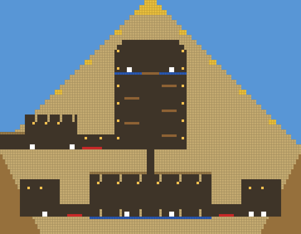

# terraria-khemet

Ancient Egypt for **Terraria** (tModLoader 1.4.4): the **Grand Pyramid of Khemet** in the desert, three pharaoh bosses, a tomb bestiary, relics and golden stone.
The Terraria sibling of [minecraft-khemet](https://github.com/SolutionsAsService/minecraft-khemet), and the first mod on the SHADW stack's Terraria adapter
(`terraria-tmodloader` in [shadw-modding](https://github.com/SolutionsAsService/shadw-modding)).



## What is in it (v0.1.0)

| | |
|---|---|
| **World** | The **Grand Pyramid of Khemet**: 121 tiles wide and 60 tall above the sand, with a foundation 34 deep. A stepped pyramid with golden courses and a gold capstone; an entrance gate and the **Hall of Gates**; the **Great Gallery**, one tall room that climbs the pyramid's slope to the **Throne Room**, with platforms up the wall; a shaft down to the **Hall of Judgement** (Anubis's court); a west **crypt** and an east **treasure vault**; spike pits, torches, pillars, lapis floors and nine stocked chests. It is placed after the vanilla Pyramids pass on the sandiest flat stretch of desert. |
| **Bosses** | **The Forgotten Pharaoh** (pre-Hardmode, 3,400 life), **Anubis, the Judge** (Hardmode, 9,500) and **The Sun Pharaoh** (post-Plantera, 42,000). Each hovers over you, then dashes, fires a fan of bolts or calls minions; below half life they attack faster and fan wider. Each has a summon item, a treasure bag, drops, a boss-bar head icon and a "downed" world flag. |
| **Enemies** | Tomb Cobra, Tomb Guardian, Sacred Scarab. They fill the pyramid and trickle through the desert. |
| **Items** | Khopesh, Khopesh of Anubis, Solar Khopesh (each cuts the undead 40% deeper); Pharaoh's Staff, Staff of Judgement, Staff of the Sun; Scarab Charm, Ankh of Life, Amulet of the Duat, Disc of Ra; Sunstone and Duat shards; the three summons (Cursed Cartouche, Scales of Judgement, Relic of Ra). |
| **Blocks** | Pharaoh Brick, Golden Sandstone, Hieroglyph Brick, Lapis Inlay, all craftable. |

Previews (drawn by the generator, not screenshots of the game): [items](preview/items.png), [tiles and projectiles](preview/tiles-and-projectiles.png), [enemies](preview/enemies.png), [bosses](preview/bosses.png).

## How it is made

Content is data: `content/*.json` (mod, items, tiles, projectiles, npcs, structures). The SHADW generator (vendored in `tools/shadwtmod/`) writes the whole tModLoader mod
folder `Khemet/`: C# for every class, every sprite, the language file, the pyramid blueprint and its world-generation code, and the build files.

```sh
python3 tools/shadwtmod/tmod.py . gen       # content/ -> Khemet/
python3 tools/shadwtmod/tmod.py . lint      # references resolve, every boss has a bag and a summon, every pyramid room is reachable
python3 tools/shadwtmod/tmod.py . check     # compile Khemet/ against a stub of the tModLoader API (needs the .NET 8 SDK)
python3 tools/shadwtmod/tmod.py . preview   # preview/*.png
```

Edit the JSON, not `Khemet/`. (With the SHADW CLI: `shadw-mod content . gen`.)

## Install

1. Install tModLoader (1.4.4) from Steam.
2. Copy the `Khemet/` folder into `Documents/My Games/Terraria/tModLoader/ModSources/`.
3. In tModLoader: Workshop > Develop Mods > Build + Reload.
4. Make a **new world** (the pyramid is added by world generation; an existing world will not have one).

## Status, stated plainly

* **Not yet built against, or loaded in, a real tModLoader.** The machine that wrote this had no route to tModLoader's releases, so the C# was compiled only against a stub of the API
  (`shadw-mod content . check`), which catches syntax, names and types but cannot prove the real API accepts the code. `.github/workflows/build.yml` has an experimental job that builds
  against a real tModLoader download. Expect to fix a few API details on the first real build.
* Nothing has been played: boss balance, the attack patterns, the spawn rates and the pyramid's feel are untested. The pyramid's layout is proven only on paper: the generator flood-fills the
  blueprint from the entrance and confirms every room can be reached, and renders `preview/grand-pyramid.png`.
* Sprites are generated pixel art and are a first pass (the boss wings are thin; the enemies use vanilla zombie and bat animation timing).
* No armour yet (a set needs the head, body and leg sheets drawn on the player template), no trophies or relics, no music, no custom walls.
* The vanilla ID names the generated code uses are listed as "unverified" by the check when they are not in the generator's confirmed list; the real build is the check on those.

See [DESIGN.md](DESIGN.md) for where this goes next.
